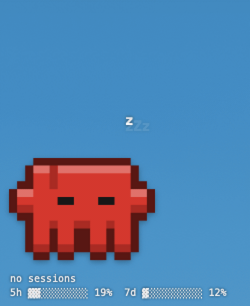

# Buddy — a Claude desktop pet for macOS

A little pixel buddy that floats on your desktop (no window, no card) and shows what **Claude Code**
is doing right now — thinking, working, waiting for you, done — from the hooks it fires locally.
Under the sprite: your plan's 5-hour and weekly limits and when they reset.

<p align="center"></p>

Built with plain `swiftc` — no Xcode, no developer account, no 7-day signing expiry.

## What it shows

| State      | Source (Claude Code hooks)                          |
|------------|-----------------------------------------------------|
| working    | `PreToolUse` — a tool is running                    |
| thinking   | between your prompt and the next tool call          |
| needs you  | permission prompt / idle prompt                     |
| ready      | `Stop` — the turn finished                          |
| sleeping   | no active session                                   |

Reactions: confetti + sound when something finishes, jumping `!` when Claude needs you, `x` eyes on
errors, hearts when you click it, breathing / blinking / the occasional wink while idle, arms that
wiggle while working. Drag it anywhere (position is remembered). Right-click or the paw icon in the
menu bar opens the menu; a menu entry reveals the active session's project folder in Finder.

Extras: **wander mode** (Behavior menu) lets the buddy stroll along the edges of the screen — never
across it — with a proper walk cycle, pausing when Claude needs you or your cursor comes close.
And it plays **tic-tac-toe** (menu → 🎮): you are X, it thinks for a moment, gloats when it wins and
sulks when it loses. It plays well but not perfectly, so you can beat it.

**Plan-limit line** (Behavior → *Show usage*, on by default): a small line under the buddy with your
current 5-hour and weekly usage and the time each window resets, e.g.
`⏳ 5h 42% → 15:12 · Week 61% → Thu 22:19`. It is hidden when the data is older than two hours.
Where the numbers come from — and what that means for your privacy — is spelled out in
*Privacy & security* below. Recent local Claude Code activity (read from Claude Code's own logs in
`~/.claude/projects`, no network) also keeps the buddy **awake**: it dozes with its eyes open instead
of dropping to sleep the moment a turn ends.

**Voice button:** the round microphone under the buddy opens Claude's *Quick Entry* (the panel you
normally get by double-tapping ⌥) — press Caps Lock there to dictate (enable dictation once in Claude's
Quick Entry settings). Buddy simulates the ⌥⌥ shortcut, so macOS asks once for Accessibility access;
without it the click falls back to opening a new chat. ⌥-click always opens a new chat. Hide it via
Behavior → *Show voice button*.

## Look

- **Style:** pixel (filled, automatic outline + bevel — default) or ASCII (terminal look, 5×12 chars).
- **Species:** pixel: Clawd, Blob, Cat, Duck, Ghost, Robot, Penguin, Octopus, Rabbit · ASCII: 18 species ·
  **Bulldog** — the first species drawn from real bitmap artwork (idle, walk, wave, sleep), listed
  under Look → Species in the pixel style.
- **Hat, eyes, color, size** (S/M/L/XL), card behind the buddy on/off, outline & shading on/off.
- **Language:** German or English (menu → Language); defaults to German on German systems, English elsewhere.
- Default species / hat / eyes are rolled deterministically from your account id ("Shuffle" in the menu).

## How it reads Claude's state

**Claude Code hooks** (real-time, fully local): `hooks/buddy-hook.sh` appends every hook event as one
JSON line to `~/Library/Application Support/Buddy/events.jsonl`; Buddy tails that file. Works for the
terminal, IDE extensions and the Claude Code tab of the desktop app. The file never leaves your machine.

**Plan limits** come from two scripts that both write `~/Library/Application Support/Buddy/usage-snapshot.json`:

- `buddy-statusline.sh` — installed as Claude Code's `statusLine` (only if you have none yet). Claude Code
  pipes its `rate_limits` into the status line; the script writes them to the snapshot and prints a compact
  line in your terminal (model · context % · 5h % · 7d %). No network, no credentials. Terminal and IDE
  sessions only — the desktop app has no status line.
- `buddy-usage.sh` — started in the background by the hook script, so the desktop app gets numbers too.
  See the next section before you decide to keep it on.

## Privacy & security

Buddy makes two kinds of network requests:

1. An unauthenticated `GET` to the public GitHub Releases API to check for a newer version
   (Behavior → *Check for updates*, on by default, toggleable). No cookies, nothing about your account.
2. `GET https://api.anthropic.com/api/oauth/usage`, authenticated with **Claude Code's own OAuth access
   token**, which `buddy-usage.sh` reads from the macOS Keychain item "Claude Code-credentials". This is
   deliberate credential reuse — a request with Claude Code's token from a different process — and you
   should know that before leaving it on. Guard rails in the script: read-only (`GET` only), the token is
   never written, refreshed or logged and travels stdin → python only, expired tokens are skipped, at most
   one request per 20 minutes and only while Claude Code is active, a `429` is honored via `Retry-After`,
   and any error is silent (the buddy just keeps the last snapshot). It needs a claude.ai subscription
   login in Claude Code (Pro/Max); with an API key or no login the line simply stays empty.
   **Don't want this?** Turn off Behavior → *Show usage*, or delete
   `~/Library/Application Support/Buddy/buddy-usage.sh` — the hook script only starts it if it exists.
   The status-line source above keeps working either way.

Buddy does **not** read your Claude session cookie. Versions ≤ 1.2.0 polled internal endpoints by reusing
the desktop app's `sessionKey` cookie from a third process — that looks like session-token replay to
anti-abuse systems and could sign your whole account out across devices. **1.3.0 removed that entirely**
(verify with `strings Buddy.app/Contents/MacOS/Buddy | grep -i sessionkey` → no matches). If you ran an
older version and saw repeated logouts, update.

## Requirements

- macOS 14+ (release zips are Apple Silicon; Intel builds from source)
- Xcode Command Line Tools (`xcode-select --install`) — that's all, no Xcode
- Claude Code (for the hooks); for the plan-limit line, Claude Code logged in with a claude.ai subscription

## Install

**Download:** grab `Buddy-<version>-arm64.zip` from [Releases](https://github.com/Mike-Hillebrand/claude-buddy-mac/releases),
unzip, move `Buddy.app` to `/Applications`. The build is ad-hoc signed (no Apple developer account),
so Gatekeeper will refuse it once. Clear the quarantine flag and it runs:

```sh
xattr -dr com.apple.quarantine /Applications/Buddy.app
open /Applications/Buddy.app
```

On first launch Buddy installs its Claude Code hooks and shows one dialog. Start Buddy **before** your
next `claude` session — running sessions pick up new hooks only after a restart.

**Or build it yourself** (Command Line Tools are enough):

```sh
./build.sh            # → build/Buddy.app
./build.sh install    # build, copy to /Applications, (re)launch
./build.sh release    # build + zip for a release
```

"Launch at login" is in the menu (SMAppService).

## Hooks

Installed automatically on first launch. Later: menu → **Behavior → Reinstall Claude Code hooks…** /
**Remove Claude Code hooks…** (a removal is remembered — Buddy won't add them back on the next start).
Manually:

```sh
python3 /Applications/Buddy.app/Contents/Resources/install-hooks.py
python3 /Applications/Buddy.app/Contents/Resources/install-hooks.py --uninstall
```

What the installer touches: `~/.claude/settings.json` gets 12 `async` hook entries (marker `buddy-hook.sh`,
no latency for Claude Code) and the `statusLine` entry if you have none; file mode and all other settings
are preserved, a copy is kept as `settings.json.buddy-backup`. The scripts are copied to
`~/Library/Application Support/Buddy/`. If another tool rewrites `settings.json`, the buddy says
"hooks not installed" instead of "no sessions" — reinstall from the menu. `tools/check-install-hooks.sh`
runs the installer against a throwaway `HOME` and checks all of this.

## Project layout

```
Sources/Core/   sprites (ASCII, pixel, bitmap), hats, eyes, speech bubble, localization, state model, usage parser — Foundation only, tested
Sources/App/    AppKit/SwiftUI: panel, view, menu, hook watcher, usage reader, settings
Resources/      app icon (.icns is generated at build time), Bulldog/ frame strips
hooks/          buddy-hook.sh, buddy-statusline.sh, buddy-usage.sh, install-hooks.py
tools/          demo.sh (records the feature demo via `Buddy --demo`), check-install-hooks.sh, uiclick.swift, screens.swift
Tests/          CoreTests.swift (also runs on Linux Swift)
```

Core tests: copy `Tests/CoreTests.swift` to `main.swift`, then
`swiftc -swift-version 5 Sources/Core/*.swift main.swift -o /tmp/t && /tmp/t`.

## Demo mode

`Buddy --demo` reads commands from `~/Library/Application Support/Buddy/cmd.txt` (one per line:
`state working Edit`, `species cat`, `hat crown`, `theme lime`, `wander 1 -1`,
`walk-now 14`, `game`, `move 4`, `menu`, `pet`, `quip <text>`, …) and ignores real hook events, so a
script can walk it through every feature for a recording — see `tools/demo.sh`. Other flags:
`--no-greeting`, `--game`, `--walk-now`, `--wander-dir=-1`.

## Drawing your own species

**Pixel:** `Sources/Core/PixelSprites.swift`: 16×14 grid, 2–3 frames. Legend: `.` empty, `#` body, `s` shade,
`l` light, `w` white, `d` dark, `a` accent (yellow), `e` eye slot (2×2 or 2×3). Outline and bevel
are added automatically.

**Bitmap:** `Sources/Core/BitmapSprites.swift`: one PNG strip per animation (idle, walk, attention, sleep),
equal-width frames side by side, alpha-transparent, under `Resources/<Name>/`; register the strips and
frame counts in `BitmapBank`, and `build.sh` bundles the folder.

## Authors

[Mike Hillebrand](https://github.com/Mike-Hillebrand) · [Mike Hillebrand Media](https://github.com/MikeHillebrandMedia) — built together with Claude.

## Notes

Not affiliated with Anthropic. The pixel sprites are original pixel art; the Bulldog frames are
AI-generated artwork supplied by the author.

## License

MIT — see [LICENSE](LICENSE).
